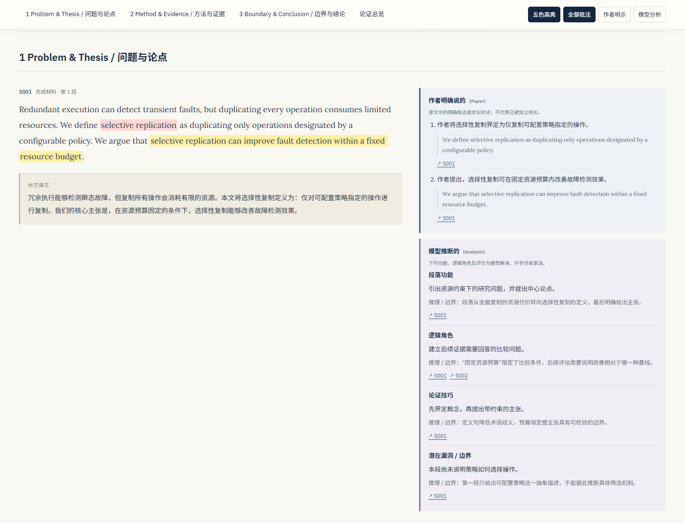

# Nature Argument Reader

**把学术论文变成可离线阅读的英中对照双栏批注 HTML，重点理解作者如何建立论证。**

A reusable reading skill and a dependency-free HTML renderer for bilingual,
paragraph-aligned academic reading. Author statements and model interpretations
are explicitly separated and linked back to source paragraphs.



## 功能

- **左栏英中对照**：完整英文段落在前，流畅、忠实的中文译文紧随其后。
- **五色高亮**：黄色标注核心论点，红色标注术语，蓝色标注证据，绿色标注让步与反驳，紫色标注方法。
- **右栏逐段批注**：解释段落功能、逻辑角色、论证技巧与潜在边界。
- **严格区分来源**：`[Paper]` 只收录原文明示内容；`[Analysis]` 必须给出依据和推理理由。
- **论证结构总览**：问题 → 论点 → 证据 → 反驳 → 结论，附核心主张概括和强弱分析。
- **单文件离线阅读**：内嵌样式、脚本、Lora / IBM Plex Sans 字体及本地图片；无需 CDN 或托管服务。
- **阅读控制**：sticky 章节导航、来源跳转、高亮开关、作者/模型批注筛选、打印样式。
- **引文往返**：点击英中正文的参考文献编号直达文末条目，自动展开折叠目录，支持返回刚才点击的引文。
- **图表与文献预览**：悬浮查看原图、图注或文献条目，点击图表标号可跳转；优先使用左栏空白，不足时放到右栏，图片支持缩放与原尺寸查看，窄屏流内展开以免遮挡正文。
- **响应式布局**：桌面双栏，手机端逐段切换为单栏。

这里的 Nature 是技能族命名，**不限于 Nature 期刊论文**。本项目不是 Nature、
Springer Nature 或 OpenAI 的官方产品。

## 安装与调用

本仓库根目录即完整技能目录，入口为 [`SKILL.md`](SKILL.md)。
将整个目录放入你的技能宿主所支持的个人或项目 skills 目录，保留目录名
`nature-argument-reader`。也可以直接让支持读取本地技能的智能体读取 `SKILL.md`。

例如，已使用 `~/.codex/skills` 管理个人技能的环境：

```sh
git clone https://github.com/whzhxh/nature-argument-reader.git ~/.codex/skills/nature-argument-reader
```

然后附上论文或本地文件路径，使用：

```text
请使用 $nature-argument-reader 阅读这篇论文。
课程信息：学术论文阅读与论证分析
生成完整的英中对照双栏批注 HTML，保留原文和图表，
重点呈现论证结构，严格区分作者明确说的与模型推断的。
```

可指定只处理某一节。课程信息不提供时，页面会如实标明。
其他 Nature 技能不是必需依赖；如果已有 `nature-reader` 的来源映射与术语表，
可以复用它们。

## 不使用智能体，先体验生成器

需要 **Python 3.10 或更新版本**，无需安装第三方 Python 包：

```sh
git clone https://github.com/whzhxh/nature-argument-reader.git
cd nature-argument-reader
python scripts/build_reader.py assets/demo-content.json --output demo.html
```

用浏览器打开生成的 `demo.html`。也可以下载
[`examples/demo.html`](examples/demo.html) 后离线打开。
演示的英文、译文和数字均为原创合成测试内容，不对应真实论文。

**生成器负责校验和排版，不会自动提取 PDF、翻译或调用模型。**
实际论文需要先由智能体或人工按
[`references/content-contract.md`](references/content-contract.md)
准备来源映射、译文和批注 JSON，再运行相同命令。

只验证输入，不写 HTML：

```sh
python scripts/build_reader.py assets/demo-content.json --validate-only
```

替换本地字体：

```sh
python scripts/build_reader.py assets/demo-content.json --output demo.html \
  --lora-font /path/to/Lora.ttf --plex-font /path/to/IBMPlexSans.ttf
```

字体与图片由生成器内嵌，最终文件不依赖原始资源目录。
生成器不发起网络请求；论文获取和可选外部引文检索由使用者的工作流决定。

## “作者明确说的”与“模型推断的”

| 分类 | 放什么 | 必须包含 |
|---|---|---|
| `[Paper]` 作者明确说的 | 作者写出的主张、结果、方法、定义或限定 | 忠实中文转述、可在原文逐字找到的短引、来源段落链接 |
| `[Analysis]` 模型推断的 | 段落功能、逻辑角色、论证技巧、评价或潜在漏洞 | 判断、依据段落、推理理由及适用边界 |
| `[External]` 可选外部补充 | 论文以外来源支持的说明 | 独立出处及链接，单独展示 |

`[Paper]` 表示论文有此陈述，**不等于结论已被独立证实**。
高亮颜色描述论证内容，不表示可信度。

不会为凑齐骨架而编造反驳，不把“所提供材料未见”改写成“作者没有做”，
不把相关性升级为因果，也不会把模型对作者意图的解读写成作者原话。
来源只有摘要或节选时，页面会明确显示范围。

## 校验与边界

生成器检查来源 ID、逐字短引、高亮重叠、分析依据与理由、来源页码模式、
段落覆盖清单、媒体路径和必需字段，并对文本进行 HTML 转义。

这些检查**不能**替代语义审核：可匹配的引文未必足以支持中文转述；
模型仍可能误译、误判段落角色或提出不成立的批评。
原文提取顺序、全文覆盖、数字与限定语均需结合源文件核对。

完整双语阅读文件只应使用用户有权使用的原文。仓库不包含真实论文全文。
如果要分享真实论文生成的阅读器，请先确认原文、图表与译文的使用权限。

## 项目结构

```text
SKILL.md                         智能体工作流与来源边界
agents/openai.yaml               技能显示信息
scripts/build_reader.py          Python 标准库校验与生成器
references/content-contract.md   JSON 数据合同
assets/reader.html               自包含 HTML 模板
assets/demo-content.json         合成文本演示输入
assets/fonts/                    字体与各自的 OFL 许可
examples/demo.html               可下载的完整离线演示
docs/                            桌面和手机截图
tests/                           生成与来源约束检查
```

运行测试：

```sh
python -m unittest discover -s tests -v
```

欢迎通过 issue 报告版面问题或来源标注错误。提交复现材料时，优先使用合成文本，
避免上传未授权论文或私人内容。

## 许可与致谢

本项目原创代码、模板、技能说明和合成示例以 [MIT License](LICENSE) 开源。
随附 Lora 与 IBM Plex Sans 字体分别遵循 SIL Open Font License 1.1，
不由 MIT 许可证替代，详情见 [THIRD_PARTY_NOTICES.md](THIRD_PARTY_NOTICES.md)。

工作流吸收了本地 Nature 技能族中逐段对照、术语一致、来源定位，
以及区分论文陈述与模型分析的设计原则。本仓库不分发其他 Nature 技能。
